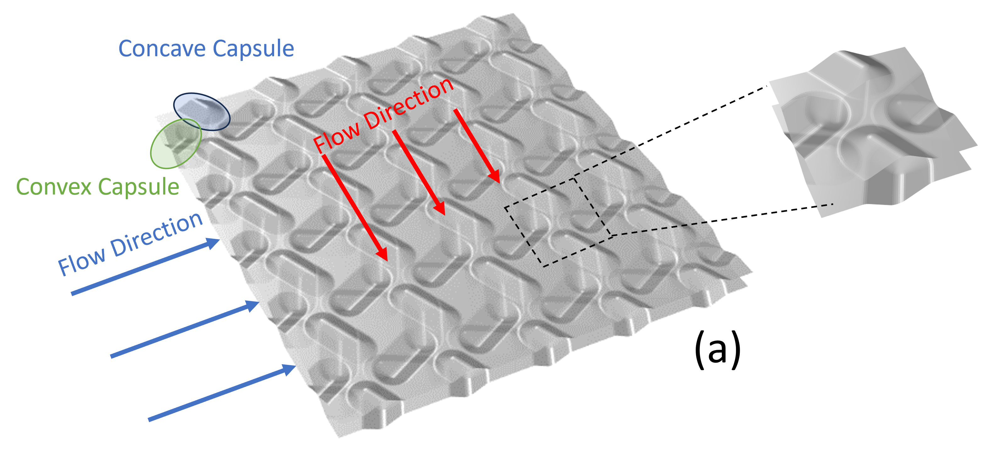
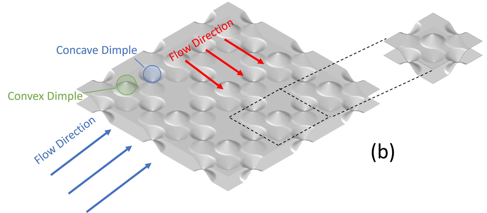
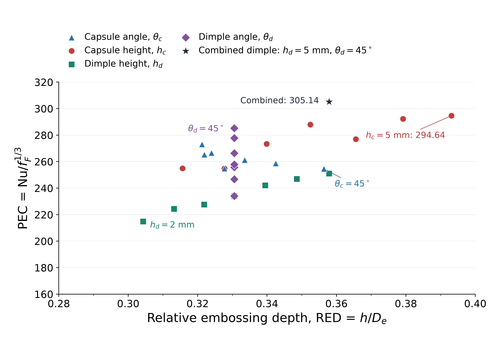

# Parametric Thermo-Hydraulic Benchmarking of Capsule and Dimple Plate Heat Exchanger Channels via Periodic Unit-Cell CFD

This repository holds the LaTeX source, figures and bibliography for a CFD study that compares **capsule-type (CPHE)** and **dimple-type (DPHE)** embossed plate heat exchanger channels side by side. Both are modelled with the same steady, single-phase RANS setup, the same periodic unit-cell approach, the same operating point (Re = 4282) and the same reporting definitions, so that differences in heat transfer and flow resistance can be attributed to the geometry rather than to how each case was computed.

<p align="center">
  
  
</p>

*Left: capsule-type (CPHE). Right: dimple-type (DPHE). Blue and green labels mark concave and convex embossings; the dashed box and inset show the repeating unit cell.*

Within the tested ranges, the highest performance evaluation criterion (PEC, a combined heat-transfer and friction score) is 305.14, for a targeted combined dimple case with a 45° flow-entry angle and 5.0 mm height. It is 3.56% above the best capsule case (294.64), a gap the study does not treat as a resolved advantage because numerical uncertainty is not quantified. See [Scope and limitations](#scope-and-limitations).

## Purpose of the study

Plate heat exchangers (PHEs) fit a large heat-transfer area into a small volume. Embossing the plates (capsules, dimples, pillows) keeps disturbing the boundary layers and strengthens convection, but the same separation, recirculation and wall shear raise pressure loss and pumping demand. An embossing therefore cannot be judged on Nusselt number alone.

The literature reports large effects from both families: for example +28–55% Nusselt number at +35–44% friction factor relative to a simple channel for a symmetric capsule layout (Hamedi et al., 2024), +39% Nusselt number relative to a flat PHE for a dimple PHE (Soman et al., 2022), and 30% less heat-transfer area than chevron plates for pillow plates (Arsenyeva et al., 2019). These figures cannot be ranked against each other. The studies differ in working fluid, Reynolds-number range, computational domain and boundary conditions, hydraulic-diameter definition, turbulence model, reference surface and performance index. Most also vary parameters within one surface family, so it is unclear whether capsule and dimple channels respond alike when angle and height change over comparable ranges.

The purpose of this study is to address that gap for one well-defined case, by benchmarking both families on a single numerical and reporting basis. It asks:

1. How do capsule angle, capsule height, dimple height and dimple flow-entry angle change the Nusselt number (Nu) and the Fanning friction factor (f_F)?
2. Which flow and temperature structures (wakes, recirculation, turbulence kinetic energy) explain those changes?
3. On one common basis, how do the two families compare in heat transfer versus flow resistance, measured by the PEC and the relative embossing depth (RED)?

## Contribution to the field

The central contribution, as the manuscript states it, is a direct side-by-side comparison of CPHE and DPHE channels under a common numerical and operating baseline. Specifically, it provides:

- **A like-for-like benchmark of two embossing families.** Same Reynolds number, fluid, thermal boundary conditions, unit-cell treatment, mesh criteria and post-processing, with matched angle (0°–45°) and height (2–5 mm, or 0.08–0.20 of the cell length) ranges in both families.
- **Geometry-dependent trade-offs on that common basis.** From 2 to 5 mm, friction rises much faster than Nu in the dimple channel (f_F +169.7% against Nu +62.7%) and less so in the capsule channel (+42.3% against +30.0%). At matched angles the capsule channel scores higher at 0° and the dimple channel at 45°. The pairing and the numbers are under [Results at a glance](#results-at-a-glance).
- **Reporting definitions written out in full.** The unit-cell hydraulic diameter, the fixed-Re reference speed, a heat-transfer coefficient that uses both walls and a case-specific fluid-domain mass-average reference temperature, the Fanning friction factor, an unnormalised PEC and the RED are all defined explicitly, so each reported number can be traced to its definition.
- **A caution about normalised metrics.** At fixed Re, a taller embossing also changes the hydraulic diameter and the reference speed. In both height sweeps Nu rises while the mean heat-transfer coefficient, total wall heat rate and pressure drop fall between the 2 mm and 5 mm cases, so a higher Nu does not imply a larger heat duty.
- **Flow-field evidence for the trends.** Mid-plane turbulence kinetic energy (TKE), streamlines and temperature fields show that angle and height mostly redistribute wakes and secondary flow rather than raising turbulence uniformly across the passage.
- **A scoped unit-cell workflow.** Lateral periodic boundaries with a streamwise quasi-periodic loop for velocity and turbulence profiles, a flow chart of the calculation sequence, mesh-sensitivity studies for both families and a four-point comparison with experiment, together with explicit statements of what the thermal results do not establish.

The results are comparative outcomes within the tested ranges. They are not design correlations.

## Study design

The study comprises four seven-case, one-factor sweeps (28 cases) plus one targeted combined dimple case. Companion parameters are held at the values below.

| Family | Varied parameter             | Range                     | Held fixed    |
| ------ | ---------------------------- | ------------------------- | ------------- |
| CPHE   | Capsule angle θ_c           | 0°–45°, 7.5° steps    | h_c = 2.5 mm  |
| CPHE   | Capsule height h_c           | 2.0–5.0 mm, 0.5 mm steps | θ_c = 22.5° |
| DPHE   | Dimple height h_d            | 2.0–5.0 mm, 0.5 mm steps | θ_d = 0°    |
| DPHE   | Dimple flow-entry angle θ_d | 0°–45°, 7.5° steps    | h_d = 3.5 mm  |
| DPHE   | Combined case                | θ_d = 45°, h_d = 5.0 mm | none          |

The sweeps share two reference points, so the 29 case labels correspond to 27 distinct solutions. The combined case is an angle–height pairing inside the dimple family. It is not a capsule–dimple hybrid and not a factorial search. θ_c is the anticlockwise angle from the mainstream flow to the capsule's major axis. Dimples are circular, so θ_d is a flow-entry angle: the dimple array is unchanged and the direction from which flow enters it is varied.

| Item               | Setting                                                                                                                                                                                                   |
| ------------------ | --------------------------------------------------------------------------------------------------------------------------------------------------------------------------------------------------------- |
| Geometry           | Capsule 20 mm long × 10 mm wide, dimple diameter 10 mm, unit-cell length 25 mm; cosine embossing profile y(x) = (h/2)[1 + cos(2πx/D)]                                                                   |
| Solver             | Ansys Fluent 2024 R1: 3-D, steady, single-phase, pressure-based, double precision                                                                                                                         |
| Turbulence         | SST k–ω, wall-resolved (y⁺ = 0.087 on the representative CPHE mesh)                                                                                                                                    |
| Fluid              | Liquid water, constant properties: ρ = 998.2 kg/m³, μ = 0.001003 Pa·s, c_p = 4182 J/(kg·K), λ = 0.6 W/(m·K)                                                                                        |
| Operating point    | Re = 4282 based on D_e; the reference speed follows from D_e and is 0.308–0.679 m/s across cases                                                                                                         |
| Thermal conditions | Inlet 293 K; both walls isothermal at 333 K; pressure outlet at 0 Pa gauge; no solid plate and no conjugate conduction                                                                                    |
| Periodicity        | Lateral faces: translational periodic pair. Streamwise: an external quasi-periodic loop maps outlet velocity components, k and ω to the inlet over 20 calculation blocks; temperature is not transferred |
| Mesh               | Poly-hexacore with 7 prism layers (first layer 0.0002 mm); orthogonality ≥ 0.1, skewness ≤ 0.8                                                                                                          |
| Numerics           | Coupled pressure–velocity; second-order pressure; second-order upwind momentum, energy, k and ω; residual targets 10⁻⁴ (continuity, momentum, k, ω) and 10⁻⁶ (energy)                              |

Reporting definitions used for every case:

```text
D_e   = 4·A₀·L / (S₁ + S₂)                       unit-cell hydraulic diameter (A₀ inlet flow area, S₁ and S₂ the two heated wall areas)
Re    = u·D_e / ν = 4282                         fixed, so the reference speed u varies with D_e
h_ave = (Q₁ + Q₂) / [(S₁ + S₂)(T_w − T_f,ave)]   both walls; T_f,ave = fluid-domain mass-average static temperature
Nu    = h_ave·D_e / λ
f_F   = Δp·D_e / (2·ρ·L·u²)                      Fanning friction factor
PEC   = Nu / f_F^(1/3)                           unnormalised
RED   = h / D_e                                  h = embossing height (h_c or h_d)
ΔPEC  = PEC_CPHE − PEC_DPHE                      matched-case difference; positive means the capsule case scores higher
```

D_e is an effective passage scale for the unit cell, not a local hydraulic diameter at every cross-section.

## Results at a glance

| Sweep                                       | PEC range    | What changes                                                                                                                                                                                                        |
| ------------------------------------------- | ------------ | ------------------------------------------------------------------------------------------------------------------------------------------------------------------------------------------------------------------- |
| Capsule angle                               | 254.6–273.0 | Nu and f_F both peak at 22.5° (79.80 and 0.03072), 15.1% and 87.5% above the 0° case                                                                                                                              |
| Capsule height                              | 254.8–294.6 | Nu rises overall to 91.83 at 5 mm; from 2 to 5 mm, Nu +30.0% and f_F +42.3%                                                                                                                                         |
| Dimple angle                                | 234.0–285.2 | Nu peaks at 30° (106.37) and f_F at 22.5° (0.06503); both are lowest at 45° (Nu −9.6%, f_F −59.2% relative to 0°), which gives the highest PEC of the sweep (285.19)                                          |
| Dimple height                               | 214.8–251.0 | Nu and f_F rise monotonically; from 2 to 5 mm, Nu +62.7% (to 104.09) and f_F +169.7% (to 0.07133)                                                                                                                   |
| Combined dimple (θ_d = 45°, h_d = 5.0 mm) | 305.14       | Highest of all cases (RED = 0.357856, Nu = 87.38, f_F = 0.023480): 3.56% above the 5 mm capsule case, 6.99% above the 45° case of the dimple-angle sweep and 21.57% above the 5 mm case of the dimple-height sweep |

Matched-case differences: across the seven angles, a least-squares line gives ΔPEC = 33.695 − 1.42984·θ (θ in degrees; R² = 0.973, RMSE 3.54), running from +39.04 at 0° to −30.61 at 45°. Across the seven matched normalised heights ΔPEC stays positive (mean 42.01, standard deviation 7.77, range 30.36–53.94) with no useful linear trend (R² = 0.087). The fit summarises seven paired cases; it is not a validated correlation. The angle pairing is CPHE at h_c = 2.5 mm with DPHE at h_d = 3.5 mm, and the height pairing is CPHE at θ_c = 22.5° with DPHE at θ_d = 0°.



*PEC versus RED for all case labels; the star is the combined dimple case. These are constructed unit-cell scores, not thermally fully developed coefficients and not uncertainty-resolved rankings.*

Values are quoted from the current manuscript source. If they diverge, the manuscript is authoritative.

## Verification and validation

- **Mesh sensitivity, CPHE** (h_c = 2.5 mm): five meshes from about 100k to 1.1M elements, with the ~800k mesh used. Between ~800k and ~1.1M, f and Nu differ by less than 2.7% and 2%, on the original reporting basis. Those Nu values were not recomputed with the final reference temperature, so they do not verify mesh independence of the revised thermal definition.
- **Mesh sensitivity, DPHE**: six meshes from 103k to 1622k cells, with the 855k mesh used. Refining from 855k to 1622k changes Nu by 2.20% and f_F by 0.095%. Grid convergence index (GCI) estimates (Celik et al., 2008) are 2.73% for 1622k/855k and 1.39% for 855k/571k. They are indicative only: the refinement ratios (1.24 and 1.14) are below the recommended 1.3 and the two pairs do not establish a consistent asymptotic limit.
- **Experimental benchmark**: four Nu values from the same quasi-periodic loop are compared with the D3 projected-area series of Du et al. (2025) over Re ≈ 2090–6597. The reported differences are +1.92%, +1.28%, −2.60% and −2.32% (mean absolute 2.03%). The reference values are digitised from a published plot, not taken from a data table. The benchmark covers Nu for one dimple geometry, is not part of the 29-case matrix, and does not by itself validate the full parametric study.

## Scope and limitations

The manuscript is explicit about what these results do and do not show:

- They are comparative outcomes for the tested ranges (angles 0°–45°, heights 2–5 mm), water at Re = 4282 and these unit-cell boundary conditions. One-factor sweeps plus a single combined case do not establish a global optimum or describe interactions between parameters.
- PEC is an unnormalised score. It is not an enhancement factor and not proof of better performance at equal pumping power. Differences of a few percent, such as the 3.56% gap above, are not treated as resolved without quantified numerical uncertainty.
- The thermal results are unit-cell heating with a prescribed 293 K inlet and quasi-periodic hydrodynamics. They are not a demonstrated thermally fully developed periodic solution; neither the block count nor a stable heat-transfer integral establishes thermal periodicity.
- Nu, f_F and PEC are normalised at fixed Re, so they do not translate into absolute heat duty or pressure drop when D_e and the reference speed differ between cases.
- The model is steady RANS with constant water properties, single-phase flow, idealised isothermal walls and no solid conduction, multiphase effects or leakage.

## Repository guide

| Path                                                                                  | Contents                                                                                                                                        |
| ------------------------------------------------------------------------------------- | ----------------------------------------------------------------------------------------------------------------------------------------------- |
| `manuscript_MDPI.tex`                                                               | Main source, typeset with the MDPI article class (`Definitions/mdpi.cls`, journal option `energies`)                                        |
| `manuscript_MDPI.pdf`                                                               | Compiled manuscript                                                                                                                             |
| `numerical_definitions.tex`                                                         | Definitions of D_e, Re, f_F, the fluid-domain reference temperature, h_ave, Nu and Pr                                                           |
| `simulation_workflow.tex`                                                           | Calculation sequence and the quasi-periodic loop flow chart                                                                                     |
| `boundary_settings.tex`, `boundary_panel.tex`                                     | Boundary-condition and solver-settings table; boundary map for Figure 2(c)                                                                      |
| `dphe_mesh_independence.tex`                                                        | DPHE mesh-sensitivity study and GCI                                                                                                             |
| `du_d3_validation.tex`, `du_d3_geometry.tex`, `du_d3_mesh.tex`, `du_d3_*.png` | Four-point benchmark against Du et al. (2025): text, geometry and mesh                                                                          |
| `figure4.tex` to `figure14.tex`                                                   | One result figure per file: Nu and f_F overview (4), TKE, streamlines and temperature at representative cases (5–12), PEC comparisons (13–14) |
| `equation_sources.tex`                                                              | Holds the`filecontents*` block that generates `energies_revision_sources.bib`                                                               |
| `references.bib`, `energies_revision_sources.bib`                                 | Bibliography                                                                                                                                    |
| `Definitions/`                                                                      | MDPI class, bibliography styles and logos                                                                                                       |
| `media/`                                                                            | Schematics, mesh images and summary plots; most of the files are not referenced by the current source                                           |
| `image_2/`                                                                          | Field renderings (TKE, 2-D streamlines, temperature) for the 28 one-factor cases                                                                |

In `image_2/`, file prefixes `CA`, `CH`, `DH` and `DA` mean capsule angle, capsule height, dimple height and dimple angle. The `FigureNN` folder numbers follow an earlier figure numbering (for example `image_2/Figure14` is used by `figure10.tex`), so follow the `\includegraphics` paths in the `figureN.tex` fragments to find the image behind a figure.

### Building the manuscript

```bash
latexmk -pdf manuscript_MDPI.tex
```

This runs pdfLaTeX and BibTeX; the committed PDF was built with TeX Live 2024.

- `energies_revision_sources.bib` is rewritten from `equation_sources.tex` on every run, so edit those entries inside `equation_sources.tex`, not in the `.bib` file.
- Build outputs (`.pdf`, `.aux`, `.log` and similar) are committed, so a local build shows them as modified.
- This repository holds the manuscript only. It contains no solver case or data files and no post-processing scripts.

## Authors and contact

Cheuk Sing Cheung¹, Christos Skarakis¹, Lance Smith², Jiyuan Tu¹, Abhijit Date¹, Kiao Inthavong¹ and Sara Vahaji¹. The manuscript acknowledges Cheung and Skarakis as first authors with similar contributions.

- ¹ School of Engineering, RMIT University, Melbourne, VIC 3000, Australia
- ² InKorr Pty Ltd, Knoxfield, VIC 3180, Australia

Correspondence: Kiao Inthavong, kiao.inthavong@rmit.edu.au

**Data availability.** As stated in the manuscript, the data are available on request from the corresponding author.

**Acknowledgements.** InKorr Pty Ltd provided resources for this research. The funding, author-contribution and conflict-of-interest statements are in the manuscript.
